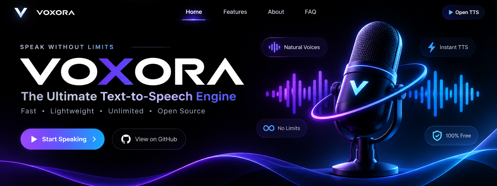

<p align="center">
  
</p>

<h1 align="center">VOXORA</h1>

<p align="center">
  <strong>Your words. Your voice. No limits.</strong><br>
  Free, browser-based AI text-to-speech. No accounts, no subscriptions, no paid APIs.
</p>

<p align="center">
  <a href="https://justincheriyantiju-glitch.github.io/voxora/"><strong>Open the live app</strong></a>
  &nbsp;·&nbsp;
  <a href="#run-it-locally">Run locally</a>
  &nbsp;·&nbsp;
  <a href="#faq">FAQ</a>
</p>

<p align="center">
  
  
  
  
</p>

---

## What it does

Paste text, pick a voice, press **Speak**. VOXORA runs the [Phonon 31M](https://huggingface.co/gradium/phonon-31m-en) speech model in your browser tab. After a one-time model download, your text is turned into speech on your own device, and you can save the result as a WAV file.

## Features

- **Phonon 31M engine:** natural English speech generated on-device
- **Male and female voices:** a built-in default plus 25 English catalog voices (13 female, 12 male) from the Phonon voice catalog
- **Browser voices:** a fallback engine that starts instantly with no download
- **WAV downloads:** save any Phonon result as a mono 24 kHz WAV file
- **Playback controls:** play, pause, resume and stop
- **Speed control:** works with both engines. Pitch control is available for browser voices
- **Long text:** up to 20,000 characters, split by sentence and joined into one file
- **Progress feedback:** download and generation progress shown as it happens
- **Responsive:** works on phones, tablets and desktops
- **No quotas:** VOXORA adds no character limits, accounts or fees

## Speech engine

| | |
|---|---|
| Model | Phonon 31M (English) |
| Parameters | 31 million |
| Quantization | Q8 |
| Download size | about 64.5 MB, once |
| Output | Mono, 24 kHz |
| Runtime | [`phonon-tts`](https://www.npmjs.com/package/phonon-tts) 0.7.1 (Rust compiled to WebAssembly, run in a Web Worker) |
| Model license | Apache 2.0 |

The model is cached by your browser, so later visits load it from your device.

## Voices

| Group | What it is |
|---|---|
| **Built-in** | The model's default voice, included in the model download. |
| **Female / Male (catalog)** | English voices from [`gradium/phonon-voices`](https://huggingface.co/gradium/phonon-voices). VOXORA reads the catalog list when the page opens and falls back to a built-in copy of the list if that fails. |

A catalog voice is a small file that downloads the first time you pick it, then stays cached. Browser voices come from your operating system and browser, so that list differs between devices.

## Privacy

- **Phonon engine:** your text is processed locally and is never sent to a VOXORA server, because VOXORA has none.
- **Downloads:** on first use the page fetches the `phonon-tts` library from jsDelivr, and the model and voice files from Hugging Face. Your text is not part of those requests.
- **Browser voices:** some browsers offer online voices that may send text to the browser vendor's servers. Use the Phonon engine if that matters to you.

## Run it locally

No build step and no dependencies. Serve the folder over HTTP, because model caching and WebAssembly need `localhost` or HTTPS, not `file://`.

```bash
git clone https://github.com/justincheriyantiju-glitch/voxora.git
cd voxora
python3 -m http.server 8000
```

Then open <http://localhost:8000>.

## Deploy to GitHub Pages

1. Push the repository to GitHub.
2. Open **Settings → Pages**.
3. Under **Build and deployment**, choose **Deploy from a branch**, select `main` and `/ (root)`, then save.
4. Your site goes live at `https://justincheriyantiju-glitch.github.io/voxora/`.

## Project structure

```
voxora/
├── index.html        # the entire app: markup, styles and script
├── README.md
└── assets/
    ├── logo.png
    └── banner.png
```

## How it works

1. The page loads `phonon-tts` as an ES module straight from jsDelivr, so its worker and WebAssembly files resolve beside it.
2. On the first Speak, the model downloads (with a progress bar) and is cached.
3. Long text is split into sentence groups. Each group is synthesized, the audio is joined, and the package's `encodeWav` turns it into a WAV file.
4. The WAV plays in the page's audio player and is offered as a download.

## Limitations

- Phonon 31M speaks **English only**. Other languages are pronounced incorrectly.
- Phonon needs a browser with WebAssembly SIMD support. Generation speed depends on your device.
- Audio is generated in full before it plays. Streaming playback is not implemented yet.
- Browser voices cannot be saved as audio files.
- The first Phonon use needs an internet connection, and depends on jsDelivr and Hugging Face being reachable.

## FAQ

**Is it really free?** Yes. There is no paid tier and nothing to sign up for.

**Why is the first Speak slow?** The Phonon model (about 64.5 MB) downloads once. After that it loads from your browser's cache.

**Why does a new voice take a moment the first time?** Each catalog voice is a separate small file, downloaded on first use.

**Can I use the audio commercially?** The Phonon 31M model is Apache 2.0. Voices and other resources have their own terms, so check those before commercial or public release.

## Roadmap

- [ ] Streaming playback while audio is still generating
- [ ] Remember voice and settings between visits
- [ ] Installable offline app (PWA)
- [ ] More languages when open-licensed models allow it

## Credits and licensing

VOXORA is an independent project and is not affiliated with the Phonon developers.

- **Phonon** is developed by [Gradium](https://gradium.ai/phonon) and builds on [Pocket TTS and the Mimi codec](https://github.com/kyutai-labs/pocket-tts) by Kyutai. The runtime is [`xn-ptts`](https://github.com/gradium-ai/xn-ptts).
- **Phonon 31M** weights are released under Apache 2.0. Voices and other model files have their own terms, so review them on [Hugging Face](https://huggingface.co/gradium) before redistributing.
- VOXORA's own code has no license file, so by default all rights are reserved. Please ask before reusing or redistributing it.

---

<p align="center">
  <strong>VOXORA</strong><br>
  Your words. Your voice. No limits.
</p>
